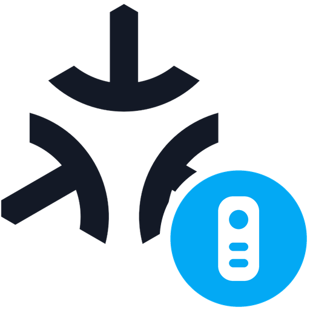

# Matter Events

[](https://github.com/piitaya/ha-matter-events/releases)
[](https://hacs.xyz/docs/faq/custom_repositories)
[](LICENSE)

Better event entities for Matter remotes and scroll wheels, such as the IKEA BILRESA.

## Why

The Matter integration shows each button of a remote as a "Button" event entity whose events are Matter specific: "Pressed once", "Pressed twice", up to "Pressed 8 times". That works for simple buttons, but it is a poor fit for a scroll wheel:

- The IKEA BILRESA appears as 9 "Button" entities: for each of its 3 layers, one for turning clockwise, one for turning counter-clockwise and one for the press.
- Turning the wheel is reported as "Pressed N times", only once the wheel stops.
- A turn of more than 8 detents is dropped, so a quick swipe does nothing.

## What it adds

This integration keeps the Matter integration as it is and adds two kinds of entities to the same devices:

- **Rotation**, one per layer of a scroll wheel. Turning the wheel sends a `rotation` event with the direction and the number of detents, while the wheel is still turning, with no limit.
- **Press**, one per button. It sends the standard button events of Home Assistant (`press_start`, `single_press`, `multi_press`…) that other integrations use too.

On an IKEA BILRESA you get **Rotation 1**, **Rotation 2**, **Rotation 3** and **Press 1**, **Press 2**, **Press 3**, one of each per layer. A remote with a single button gets one **Press** entity.

It is temporary: the same changes are planned for the Matter integration of Home Assistant Core ([home-assistant/core#177101](https://github.com/home-assistant/core/pull/177101) and a follow-up for scroll wheels). Remove this integration once they are released.

## Installation

Requires Home Assistant 2026.12 or later, with the Matter integration set up.

1. Add this repository to the Marketplace and install **Matter Events**:

   [](https://my.home-assistant.io/redirect/marketplace_repository/?owner=piitaya&repository=ha-matter-events&category=integration)

2. Restart Home Assistant.
3. Add the integration. There is nothing to configure:

   [](https://my.home-assistant.io/redirect/config_flow_start/?domain=matter_events)

The new entities show up on your Matter devices, including devices you add later.

## Example

Dim a light with the first layer of a scroll wheel, 5 % per detent:

```yaml
alias: Dim the living room light with the scroll wheel
triggers:
  - trigger: event.received
    target:
      entity_id: event.scroll_wheel_rotation_1
    options:
      event_type:
        - rotation
actions:
  - action: light.turn_on
    target:
      entity_id: light.living_room
    data:
      brightness_step_pct: >-
        {{ trigger.to_state.attributes.steps
           * (5 if trigger.to_state.attributes.direction == 'clockwise' else -5) }}
mode: parallel
```

## Events

**Rotation** has one event type, `rotation`, with these values in the event data:

- `direction`: `clockwise` or `counter_clockwise`
- `steps`: the number of detents since the previous event

**Press** has the event types the button supports, among these:

| Event type | When |
|---|---|
| `press_start` | The button is pressed down |
| `press_end` | The button is released |
| `long_press_start` | The button is held down |
| `long_press_end` | The button is released after being held down |
| `single_press` | The button was pressed once |
| `multi_press` | The button was pressed several times, `press_count` in the event data gives how many |

## Limits

- The integration relies on internal parts of the Matter integration, which can change in any release of Home Assistant.
- After a reload of the Matter integration, reload Matter Events too.
